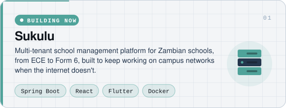
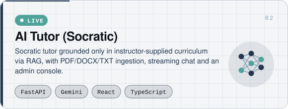
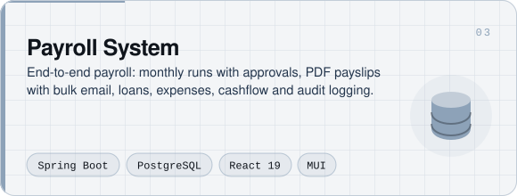
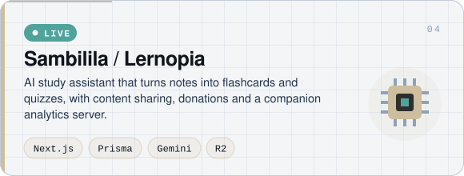
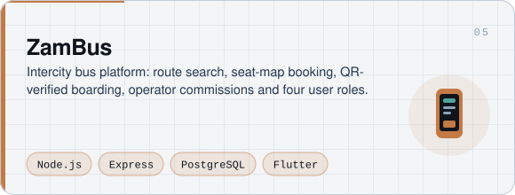
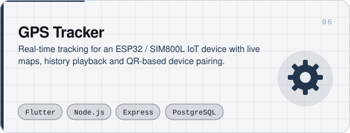
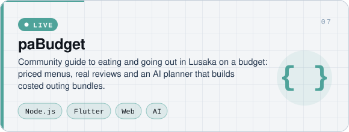
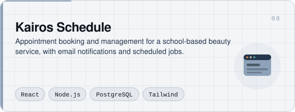

<picture><source media="(prefers-color-scheme: dark)" srcset="assets/banner-dark.svg"></picture>

 

<picture><source media="(prefers-color-scheme: dark)" srcset="assets/stats-dark.svg"></picture>

<picture><source media="(prefers-color-scheme: dark)" srcset="assets/h-about-dark.svg"></picture>

I design and build user-centric software, from AI-powered learning tools to enterprise payroll systems. My core stack is **Flutter** for mobile, **Node.js** and **Spring Boot** for backend services, and **React / Next.js** for the web.

I've delivered working products in AI-assisted education, fintech and IoT tracking, and I take ownership across the full stack: database design, REST API development and user interface implementation.

> **Education:** Bachelor of Science in Computer Science (Software Engineering), University of Zambia
> **Based in:** Lusaka, Zambia

<picture><source media="(prefers-color-scheme: dark)" srcset="assets/divider-dark.svg"></picture>

<picture><source media="(prefers-color-scheme: dark)" srcset="assets/h-projects-dark.svg"></picture>

<table>
<tr>
<td width="50%"><a href="https://github.com/devKanyanta/sukulu"><picture><source media="(prefers-color-scheme: dark)" srcset="assets/card-1-dark.svg"></picture></a></td>
<td width="50%"><a href="https://socratic.devkanyanta.me"><picture><source media="(prefers-color-scheme: dark)" srcset="assets/card-2-dark.svg"></picture></a></td>
</tr>
<tr>
<td width="50%"><a href="https://github.com/devKanyanta/payroll-system-java-react"><picture><source media="(prefers-color-scheme: dark)" srcset="assets/card-3-dark.svg"></picture></a></td>
<td width="50%"><a href="https://sambilila.netlify.app"><picture><source media="(prefers-color-scheme: dark)" srcset="assets/card-4-dark.svg"></picture></a></td>
</tr>
<tr>
<td width="50%"><a href="https://github.com/devKanyanta/zambus"><picture><source media="(prefers-color-scheme: dark)" srcset="assets/card-5-dark.svg"></picture></a></td>
<td width="50%"><a href="https://github.com/devKanyanta/gps-tracker"><picture><source media="(prefers-color-scheme: dark)" srcset="assets/card-6-dark.svg"></picture></a></td>
</tr>
<tr>
<td width="50%"><a href="https://pabudget.devkanyanta.me"><picture><source media="(prefers-color-scheme: dark)" srcset="assets/card-7-dark.svg"></picture></a></td>
<td width="50%"><a href="https://github.com/devKanyanta/appointment-booking-system"><picture><source media="(prefers-color-scheme: dark)" srcset="assets/card-8-dark.svg"></picture></a></td>
</tr>
</table>

Cards with a **LIVE** tag link to the running site. The rest link to the repository, and each repo has its own README with full setup instructions. GPS Tracker also has a [backend repo](https://github.com/devKanyanta/gps-tracker-backend).

<picture><source media="(prefers-color-scheme: dark)" srcset="assets/divider-dark.svg"></picture>

<picture><source media="(prefers-color-scheme: dark)" srcset="assets/h-skills-dark.svg"></picture>

**Mobile** 

**Backend** 

**Web** 

**AI** 

**Data & infrastructure** 

<picture><source media="(prefers-color-scheme: dark)" srcset="assets/divider-dark.svg"></picture>

<picture><source media="(prefers-color-scheme: dark)" srcset="assets/h-focus-dark.svg"></picture>

**[Sukulu](https://github.com/devKanyanta/sukulu)**: a multi-tenant school management platform for Zambian schools that keeps working on campus networks when the internet doesn't. Alongside it, I'm continuing to develop **[AI Tutor](https://socratic.devkanyanta.me)**, an interactive learning assistant that delivers personalised, curriculum-grounded instruction through structured courses.

<a href="https://github.com/devKanyanta"><picture><source media="(prefers-color-scheme: dark)" srcset="https://github-readme-stats.vercel.app/api/top-langs/?username=devKanyanta&layout=compact&hide_border=true&bg_color=0E1319&title_color=6FB0DC&text_color=E8EBEE&card_width=420"></picture></a>

<picture><source media="(prefers-color-scheme: dark)" srcset="assets/h-contact-dark.svg"></picture>

I'm always exploring technology-driven business ideas that solve everyday problems, and I enjoy coding challenges in my spare time. If you have something worth building, get in touch through the contact form on my site.

[**Visit the 3D portfolio**](https://devkanyanta.me) · [LinkedIn](https://zm.linkedin.com/in/mapalo-kanyanta-840553240) · [Download CV](https://devkanyanta.me/Mapalo_Kanyanta_CV.pdf)

